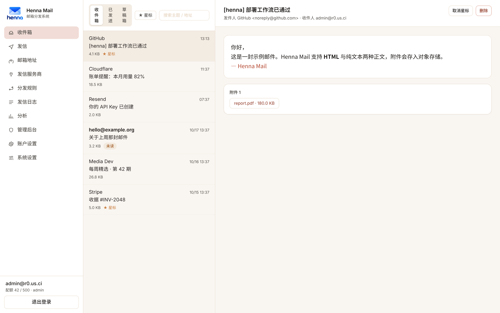
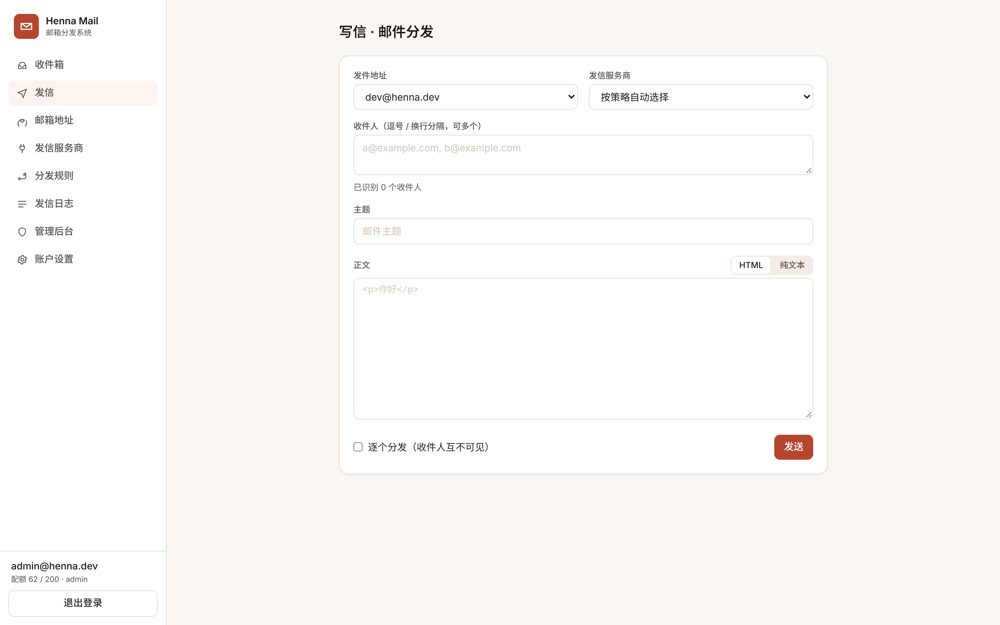
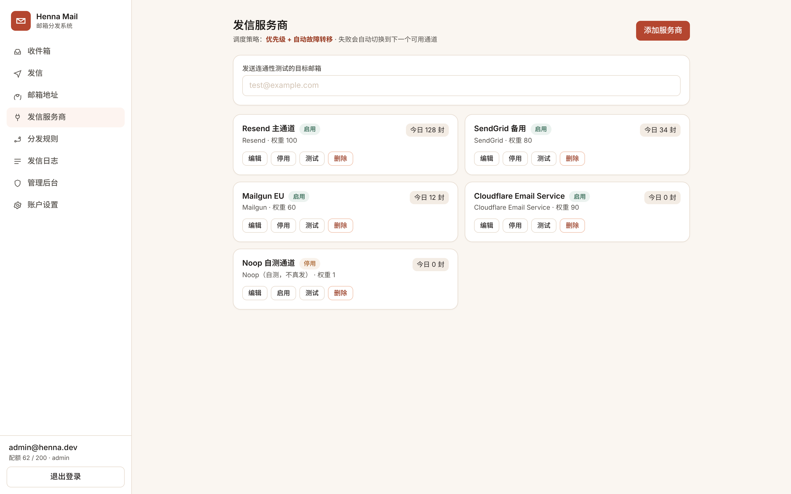
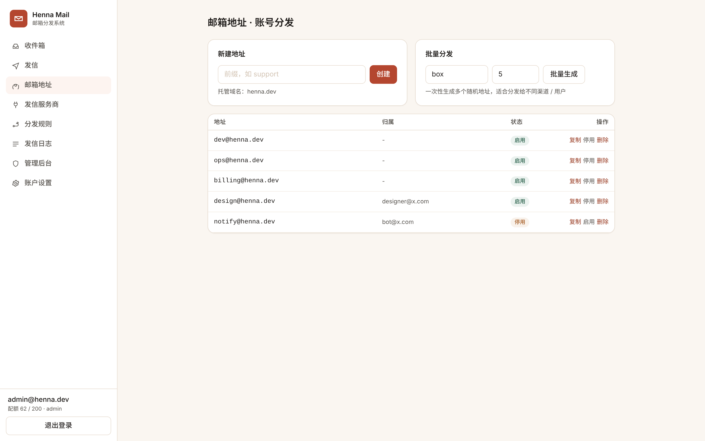
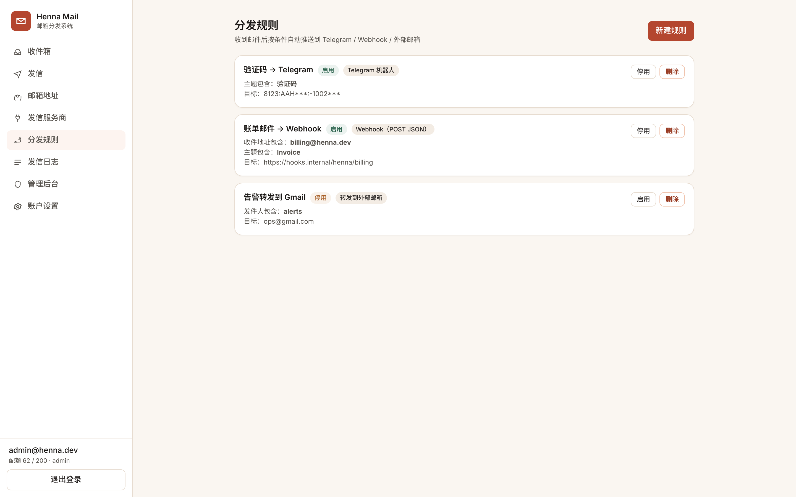
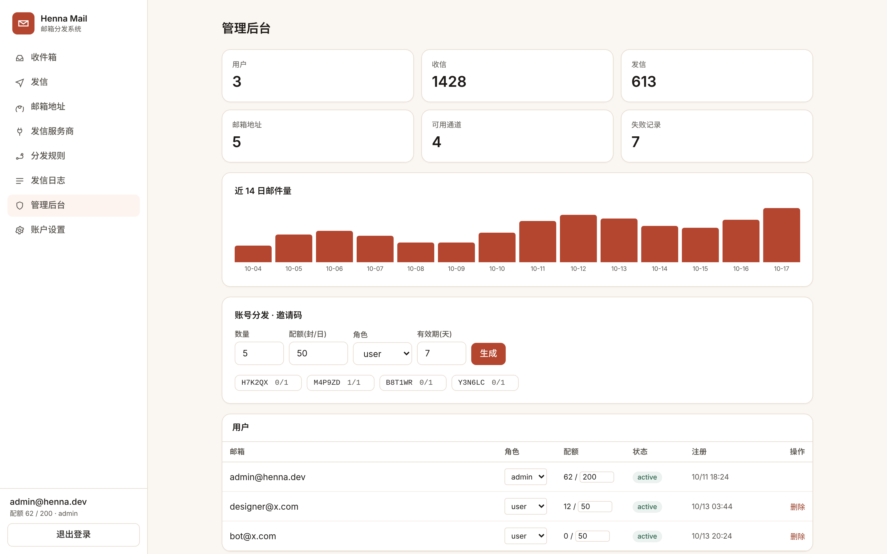
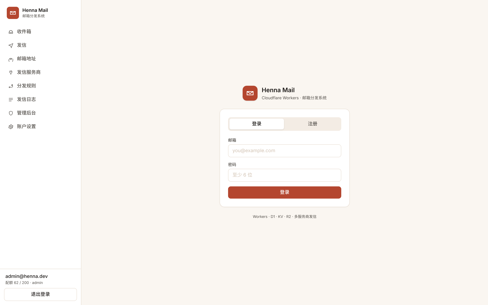
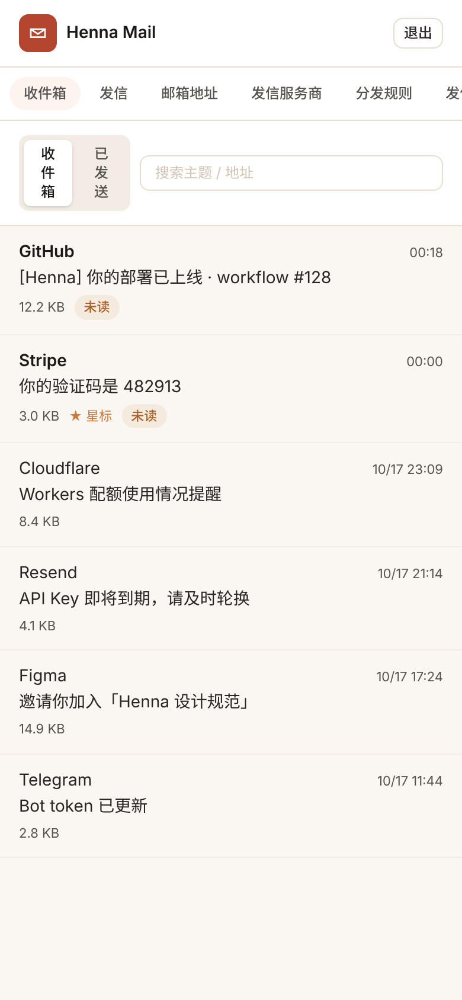

# Henna Mail · 边缘邮箱分发系统

一个跑在 Cloudflare Workers 上的邮箱分发系统：收信（Email Routing）+ 发信（多服务商可插拔）+ 账号分发（邀请码 / 批量开户）+ 规则分发（Telegram / Webhook / 外部邮箱转发）。

参考设计：[Cloud Mail](https://github.com/maillab/cloud-mail) / [doc.skymail.ink](https://doc.skymail.ink)。本项目为独立实现，全栈 TypeScript。



---

## 已验证清单

| 项 | 结果 |
|---|---|
| Worker TypeScript 类型检查（`tsc --noEmit`） | 通过，0 error |
| Worker 打包（esbuild bundle） | 通过，208 KB |
| 前端生产构建（Vite + Tailwind v4） | 通过，CSS 26.6 KB / JS 96 KB |
| 冒烟测试（12 项） | 12 passed, 0 failed |
| 界面预览截图 | 8 张，0 个蓝紫像素 |

冒烟测试覆盖：口令哈希与校验、JWT 签发/验签/过期拒绝、服务商优先级调度、故障自动转移、指定通道（pinned）、全部失败与无通道的兜底报错。

---

## 一、架构选型：为什么是 TypeScript 而不是 JavaScript

| 维度 | TypeScript（选定） | JavaScript |
|---|---|---|
| Workers Bindings | `Env` 接口把 DB / KV / R2 / SEND_EMAIL 全部类型化，写错 binding 名编译期就报错 | 只能在运行时炸 |
| 发信服务商适配器 | `MailProvider` 接口约束 7 个适配器签名一致，新增服务商不可能漏字段 | 靠人肉对齐 |
| Hono 路由 | `c.req.json()` / `c.json()` 端到端类型推导 + RPC 类型共享 | 无 |
| D1 结果 | `T | null` 显式处理空行，配合自定义 `queryOne<T>()` | 隐式 any，拼错列名才发现不了 |
| 规模 | 单仓库多包，重构安全 | 千行以上开始失控 |

结论：**全栈 TS**。JS 唯一优势是省掉构建，但 Workers 本来就走 wrangler 构建（esbuild），这点优势不存在。

## 二、整体架构

```
                          ┌───────────────────────────────────────┐
   浏览器 / 移动端  ─────▶ │  Cloudflare Workers (Hono 4, TS)      │
   Vue3 + Tailwind        │  ├─ /api/*        REST + JWT + RBAC   │
   (静态资源 assets)       │  ├─ /*           SPA 静态托管         │
                          │  ├─ email()      Email Routing 收信    │
   Cloudflare Email  ────▶│  └─ scheduled()  日清 / 配额重置       │
   Routing (MX)           └───────────────┬───────────────────────┘
                                          │
        ┌─────────────────┬───────────────┼────────────────┬──────────────┐
        ▼                 ▼               ▼                ▼              ▼
    D1 (SQLite)        KV              R2            发信服务商        通知出口
    用户/地址/邮件     会话/限流/配置    附件存储        Resend          Telegram
    服务商/规则/日志                                SendGrid          Webhook
                                                   Mailgun           转发邮箱
                                                   Brevo
                                                   Postmark
                                                   Cloudflare Email Service
                                                   noop（自测）
```

### 目录

```
henna/
├── worker/                       # 后端：Cloudflare Workers
│   ├── src/
│   │   ├── index.ts              # fetch / email / scheduled 三入口
│   │   ├── env.ts                # Env bindings 类型
│   │   ├── db/schema.ts          # D1 建表 + 幂等迁移
│   │   ├── lib/                  # jwt / crypto / http / mime / response
│   │   ├── middleware/auth.ts    # JWT 鉴权 + RBAC + API Key
│   │   ├── providers/             # ★ 发信服务商适配器（可插拔）
│   │   │   ├── types.ts          #   MailProvider 统一接口
│   │   │   ├── resend.ts  sendgrid.ts  mailgun.ts
│   │   │   ├── brevo.ts   postmark.ts  cloudflare.ts  noop.ts
│   │   │   └── index.ts          #   注册表 + failover/round-robin/指定
│   │   ├── routes/               # auth / mailbox / message / send
│   │   │                         # provider / rule / admin / openapi
│   │   └── email/receive.ts      # 入站 MIME 解析与落库
│   ├── wrangler.jsonc
│   └── package.json
├── web/                          # 前端：Vue 3 + Vite + Tailwind CSS v4
│   └── src/{views,components,api.ts,store.ts}
├── .github/workflows/deploy.yml  # 部署方式一：GitHub Actions
├── scripts/deploy.sh             # 部署方式二：一键 CLI 脚本
└── scripts/seed.ts               # 可选：灌入演示数据
```

## 三、UI 方案：Tailwind CSS（而非 Element UI）

- Workers 静态资源按体积计费传输，Element Plus 全量组件库 + 主题 CSS 明显更重；Tailwind v4 只产出用到的 utility。
- 需求明确要求**不要蓝紫渐变**，Tailwind v4 的 `@theme` 可以直接改设计令牌（色板、圆角、字体），改一套主题只动一个文件；Element Plus 要覆盖大量 `--el-*` 变量。
- 本系统 90% 界面是列表 / 表单 / 卡片，Tailwind 手写这些比拖组件库更可控。

设计令牌（暖赭 henna 色系，无蓝紫渐变）：

```css
@theme {
  --color-henna-500: #b4462f;   /* 主色 · 海娜赭红 */
  --color-clay-500:  #c97b3c;   /* 辅色 · 陶土橙 */
  --color-ink-900:   #1c1917;   /* 墨底 */
  --color-sand-50:   #faf6f1;   /* 米白底 */
  --color-jade-500:  #3f7d63;   /* 状态色 · 墨绿 */
}
```

## 四、发信服务商：可配置、可切换、可容灾

服务商配置存在 D1 的 `mail_provider` 表（API Key 加密存 KV/D1 secret），运行时动态装配，改配置不需要重新部署。

统一接口：

```ts
export interface MailProvider {
  readonly kind: ProviderKind;          // resend | sendgrid | ...
  send(msg: OutgoingMail, cfg: ProviderConfig, env: Env): Promise<SendResult>;
}
```

调度策略（`mail_provider.strategy`）：

| 策略 | 行为 |
|---|---|
| `priority` | 按 `weight` 降序依次尝试，第一个成功即返回，失败自动 failover 到下一个 |
| `round_robin` | 在启用集合中轮询，平摊配额（Resend 免费 3000/月，可叠加多家） |
| `pinned` | 固定在某一封发信请求上指定 `providerId` |

支持：单发、群发（多收件人逐个投递）、附件（base64 → multipart）、HTML/纯文本双版本、自定义 `from` 域名、发送结果落 `mail_log` 表。

## 五、部署：两种方式，全程非手动

两种方式都**不需要在 Cloudflare Dashboard 点鼠标**，D1 / KV / R2 都是脚本自动创建并回写 ID。

### 方式一 · GitHub Actions（推荐，push 即部署）

工作流已就位：`.github/workflows/deploy.yml`，默认分支推送即触发，无需任何手动操作。

在仓库 `Settings → Secrets and variables → Actions` 配置：

| Secret | 说明 |
|---|---|
| `CLOUDFLARE_API_TOKEN` | 含 Workers / D1 / KV / R2 编辑权限 |
| `CLOUDFLARE_ACCOUNT_ID` | 账户 ID |
| `JWT_SECRET` | 会话签名密钥，**随便打一个别人猜不到的字符串即可**（见下方说明） |
| `ADMIN_EMAIL` | 首个管理员邮箱，如 `admin@your.domain` |
| `MAIL_DOMAINS` | JSON 数组，如 `["your.domain"]` |

推送到 `main` 即自动：建资源 → 迁库 → 部署前端 + Worker。也支持 Actions 面板 `Run workflow` 手动触发。

### 方式二 · 一键 CLI 脚本（本地 / 服务器）

```bash
export CLOUDFLARE_API_TOKEN=xxx
export CLOUDFLARE_ACCOUNT_ID=xxx
export JWT_SECRET=web3hennamail      # 随便打，别让别人知道就行
export ADMIN_EMAIL=admin@your.domain
export MAIL_DOMAINS='["your.domain"]'
./scripts/deploy.sh            # 自动建资源 → 迁库 → 构建 → 部署
```

脚本幂等：资源已存在则复用，重复执行安全。

> **关于 `JWT_SECRET`：不用生成 32 位随机串。**
> 它只用来给登录会话签名，值本身多长、多随机并不重要，**关键是只有你自己知道**。
> 直接填 `web3hennamail` 这种随手打的字符串完全够用，也好记。
> 唯一要注意的是部署后别改——改了会让所有已登录用户被迫重新登录。
> 它同时是 `/api/init/<JWT_SECRET>` 这条初始化接口的口令，所以别泄露。

### 部署后的收尾（DNS 侧， unavoidable）

1. Cloudflare 控制台 → 域名 → **Email → Email Routing**，开启并把 MX 指向 Cloudflare。
2. Routing rules 中把目标地址 / Catch-all → **Send to Worker** → 选 `henna-mail`。
3. 访问 `https://<你的域名>/api/init/<JWT_SECRET>` 完成建表（脚本与 Actions 已自动调用，也可手动兜底）。
   用本文的示例值就是：`https://<你的域名>/api/init/web3hennamail`

## 六、本地开发

```bash
cd worker && npm i && npm run d1:local   # 本地 SQLite 建表
cd worker && npm run dev                 # http://localhost:8787
cd web    && npm i && npm run dev        # http://localhost:5173 (代理 /api 到 8787)
```

首次注册的用户自动成为 `admin`。

## 七、界面预览

| 页面 | 预览 |
|---|---|
| 收件箱 |  |
| 写信 · 分发 |  |
| 发信服务商 |  |
| 邮箱地址 |  |
| 分发规则 |  |
| 管理后台 |  |
| 登录 |  |
| 移动端 |  |

预览图为本地 mock 数据渲染（脚本：`scripts/preview-server.mjs`），非线上实例。

## 八、开放 API

所有 `/api/*` 均可用 `Authorization: Bearer <jwt>` 或 `X-Api-Key: <key>` 调用：

```bash
curl -X POST https://<domain>/api/send \
  -H "Authorization: Bearer $TOKEN" \
  -H 'Content-Type: application/json' \
  -d '{"from":"a@your.domain","to":["b@example.com"],"subject":"hi","html":"<b>hi</b>"}'
```

## 九、测试

```bash
cd worker
npx esbuild src/test/smoke.ts --bundle --format=esm --platform=node --target=node20 --outfile=/tmp/smoke.mjs
node /tmp/smoke.mjs     # 12 passed, 0 failed
```

## License

MIT
